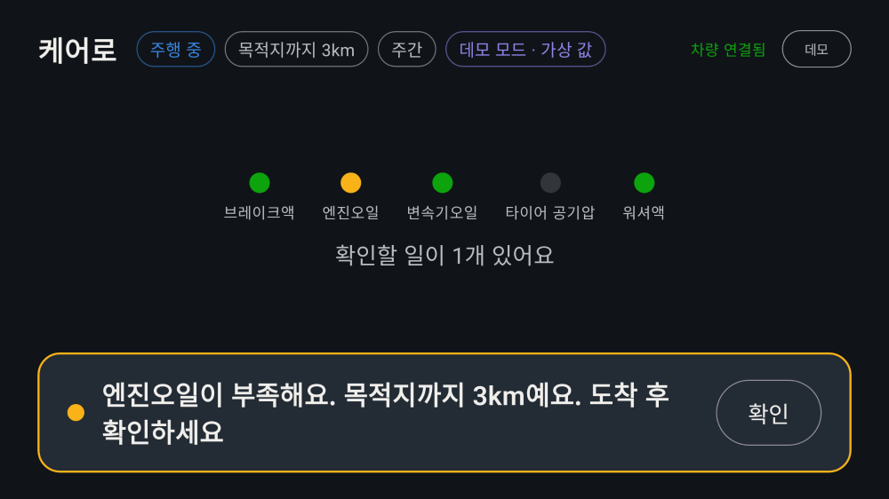
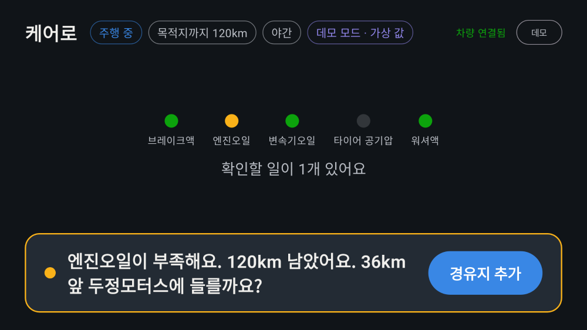
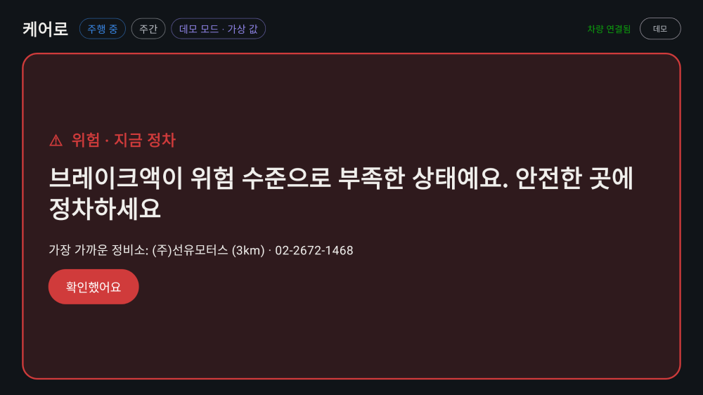
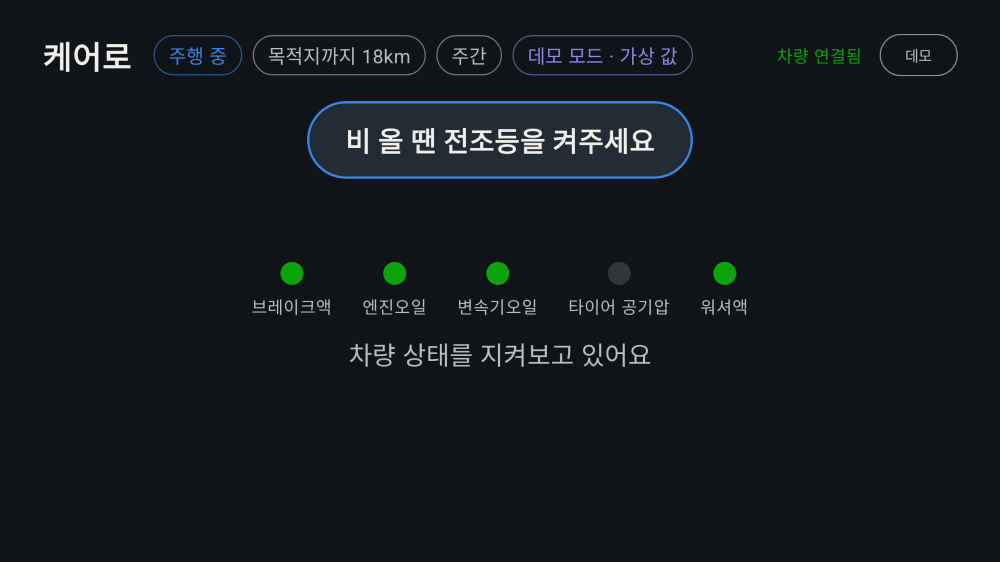
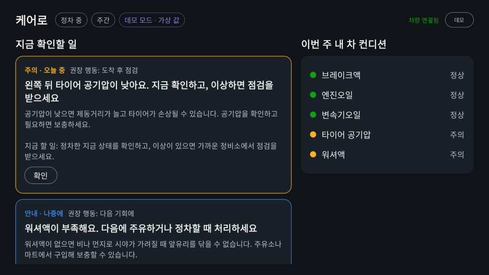
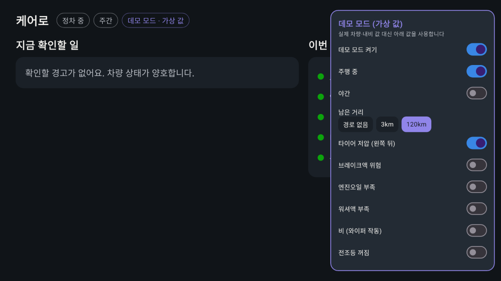

# 케어로 (Carero)

**차량 경고가 뜨면 남은 경로·시간대·주행 상태·주변 정비소를 함께 판단해, 같은 경고라도 상황에 맞게 "지금 무엇을 해야 하는지" 결정해 주는 상황판단형 차량 케어 앱**

현대자동차그룹 차량용 앱 개발 공모전(Pleos Connect) 출품작입니다.

| 같은 엔진오일 부족 경고, 집까지 3km | 같은 경고, 야간 고속도로 120km |
|---|---|
|  |  |
| **브레이크액 위험 → 즉시 정차** | **비 오는데 전조등 꺼짐 → 한 줄 제안** |
|  |  |
| **정차 중: 상세 안내와 차량 컨디션** | **시연용 데모 패널** |
|  |  |

## APK 위치

- `apk/케어로팀_케어로_release.apk` (release 빌드)

## 실행 방법

1. Android Studio에 **Pleos Connect Emulator**(API 34 시스템 이미지)를 설치하고 실행합니다. ([Pleos Connect 개발 환경 설정 가이드](https://document.pleos.ai/docs/pleos-only/connect-sdk-pleos/))
2. APK를 설치합니다.
   ```bash
   adb install -r "apk/케어로팀_케어로_release.apk"
   ```
3. 앱 목록에서 **케어로**를 실행합니다. 처음 실행하면 차속 권한(`android.car.permission.CAR_SPEED`)을 허용해 주세요.
4. 에뮬레이터의 **Virtual Console**에서 기어(D = 주행 중), 앞유리 와이퍼, 외부 조명 모드를 바꾸면 화면이 바뀝니다. (에뮬레이터에서 확인: 기어 D + 와이퍼 Low + 전조등 끔 → "비 올 땐 전조등을 켜주세요")
5. 내비게이션에서 목적지를 설정하면 남은 거리를 반영해 판단이 달라집니다.

### 데모 모드
오른쪽 위 **데모** 버튼을 누르면 가상 값으로 시나리오를 재현할 수 있습니다(화면 상단에 "데모 모드 · 가상 값"이 표시됩니다). 에뮬레이터에서 바꾸기 어려운 값(주행 중 여부, 남은 거리 등)을 시연할 때 사용합니다.

## 테스트 환경 및 설정

- Pleos Connect Emulator (Android 14, API 34)
- Pleos Vehicle SDK 2.3.2, NaviHelper SDK 3.0.5
- 빌드: JDK 17 이상, Gradle 8.10.2, AGP 8.8.2, Kotlin 2.0.21, minSdk 28 / targetSdk 35
- 소스에서 빌드: `./gradlew :app:assembleRelease`
- 단위 테스트: `./gradlew :app:testDebugUnitTest` (상황 판단 엔진 16개 테스트)

## 주요 기능

| 기능 | 설명 |
|---|---|
| 상황 판단 엔진 | 경고 심각도 × 남은 거리 × 시간대 × 주행 상태 × 정비소 접근성으로 행동 4종(즉시 정차 / 경로 위 정비소 경유 / 도착 후 점검 / 다음 기회에) 결정 |
| 경로 연동 정비소 안내 | 목적지 방향에 있고 우회 거리가 짧은 정비소를 골라 버튼 한 번으로 경유지 추가 |
| 안전 운전 제안 | 와이퍼 작동(비) + 전조등 꺼짐, 일몰 후 전조등 꺼짐 → 한 줄 제안 (같은 주행 중 반복하지 않음) |
| 정차 후 상세 안내 | 원인과 조치 방법, 이번 주 차량 컨디션 |
| 경고등 사전 | 계기판 경고등 51종의 생김새·뜻·할 일을 위험도(바로 정차 / 바로 조치 / 빨리 점검 / 안내 표시)별로 정리. 정차 중에만 열리고 출발하면 닫힘 |
| 경고등 상황 판단 (확장 기능 미리보기) | 켜진 경고등을 같은 상황 판단 엔진에 넣음: 빨간 위험등은 즉시 정차, 노란 점검등은 남은 거리에 따라 도착 후 점검 / 정비소 경유, 안전벨트·연료 부족 등은 바로 조치. 아래 '알려진 제약' 참고 |

주행 중에는 한 줄 안내와 버튼 하나만 보여주고(`distractionOptimized`), 상세 안내는 정차했을 때만 보여줍니다.

## Pleos SDK 사용

| SDK | API | 용도 |
|---|---|---|
| Vehicle · Safety | `registerBrakeFluidLevelState`, `registerEngineOilLevelState`, `getTransmissionOilLevelState`, `registerLowWasherFluidWaringState` | 브레이크액·엔진오일·변속기오일·워셔액 |
| Vehicle · Wiper | `registerWiperState`, `getCurrentWiperSwitch` (앞유리) | 비 감지 |
| Vehicle · Light | `registerLowBeamLightState` | 전조등 상태 |
| NaviHelper | `onDestinationInfo`(남은 거리·시간·목적지), `onCurrentLocationInfo`, `addWaypoint` | 경로 맥락, 정비소 경유지 추가 |
| AAOS CarPropertyManager | `PERF_VEHICLE_SPEED`, `GEAR_SELECTION` | 주행/정차 판단 (2km/h 이상 또는 D 기어) |

- 조회 권한만 선언하고 차량 제어 권한은 쓰지 않습니다.
- 지원하지 않는 차종·기능은 "미지원 차종"으로 표시하고 판단에서 뺍니다.
- 변화가 잦지 않은 값은 리스너로 구독하고, 리스너가 없는 값만 주기적으로 조회합니다(변속기오일 30초, 와이퍼 스위치 3초).

## 코드 구조

```
app/src/main/java/app/carero/
├── engine/          상황 판단 엔진 (안드로이드 의존성 없는 순수 Kotlin)
│   ├── DecisionEngine.kt   행동 결정, 경로 위 정비소 선택, 안전 운전 제안
│   ├── Messages.kt         안내 문구
│   ├── Telltales.kt        경고등 사전(생김새·뜻·할 일·위험도)
│   └── Geo.kt              거리 계산, 일출·일몰 계산
├── data/            Pleos SDK·AAOS 연동, 정비소 데이터
├── ui/CareroApp.kt  Jetpack Compose 화면
└── MainViewModel.kt
```

## 데이터 출처

- 정비소 목록(`app/src/main/assets/repair_shops.json`): 공공데이터포털 「충청남도_전국자동차정비업체 정보」, 「서울특별시 영등포구_자동차정비업체 인허가 현황」의 주소를 OpenStreetMap Nominatim으로 지오코딩한 시연용 표본입니다(도로 단위 정밀도). 서비스 시 「전국자동차정비업체표준데이터」로 교체할 예정입니다.
- 일몰 시각은 NOAA 일출·일몰 공식으로 계산합니다.

## 알려진 제약

- 계기판 경고등은 실제 데이터로 받지 않습니다. 경고등 목록 API(`Safety.getTelltalesInfo`·`registerTelltales`)는 공개 문서에 없는 권한 `pleos.car.permission.PRIVATE_CAR_SAFETY`가 필요하고, Pleos 문서상 승인되지 않은 권한·API를 쓰면 앱 심사를 통과할 수 없기 때문입니다. 그래서 `PleosVehicleSource.USE_TELLTALE_API = false`로 호출하지 않고, 경고등 판단은 데모 모드에서 확장 기능 미리보기로 보여줍니다. 에뮬레이터에서는 이 권한을 넣으면 Virtual Console의 Telltales(안전벨트·엔진 점검·ABS·엔진 과열 등)가 앱에 그대로 들어와 판단되는 것을 확인했으므로, 권한 승인을 받으면 스위치와 권한 한 줄로 켤 수 있습니다.
- 타이어 저압은 실제 데이터로 판단하지 않습니다. 공개 API `Tire.getLowTirePressure`는 저압 **기준값**(임계 압력)을 돌려주고, 실제 공기압(`getTirePressure`)과 경고등(Telltales)은 비공개 API이기 때문입니다(에뮬레이터에서 4개 바퀴 모두 기준값이 반환되는 것을 확인). 데모 모드에서만 확장 기능 미리보기로 보여줍니다.
- 에뮬레이터 Virtual Console에는 브레이크액·엔진오일·변속기오일 수준을 바꾸는 항목이 없어, 해당 경고는 데모 모드로 시연합니다.
- 현재 공개 SDK에는 장소 검색 API가 없어 정비소 목록을 앱에 내장했습니다.

